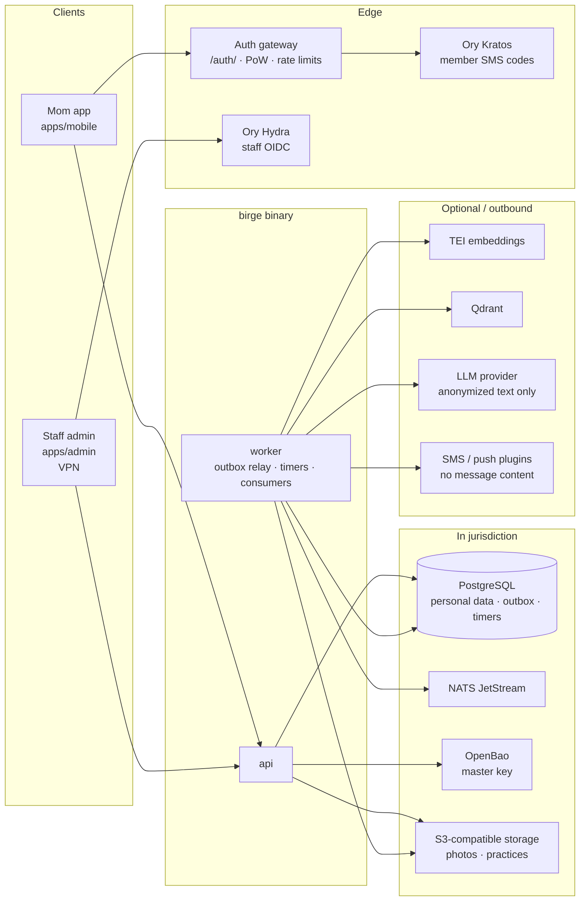

# Birge overview

Birge («Бірге», “together”) is an open-source peer-support and mental-health platform for mothers and other caregivers of children with special needs. One deployment serves one country. Interface languages at launch: Kazakh, Russian and English (`kk`, `ru`, `en`).

This page is for people who will run or maintain Birge without having built it. Technical detail lives in [architecture.md](architecture.md) and the ADRs. End-to-end flows are in [scenarios.md](scenarios.md). Staff day-to-day work is in [handbook/staff.md](handbook/staff.md). What is not finished yet is listed in [roadmap.md](roadmap.md).

## Who uses it

| Role | App | How they sign in | What they do |
| --- | --- | --- | --- |
| Member (mother / caregiver) | Mom app (`apps/mobile`) | Phone number + SMS code (Ory Kratos behind the auth gateway) | Check-ins, AI assistant, peers, SOS, emergency plan, rights articles, chat |
| Mentor (experienced member) | Mom app | Same as members; staff grant the role | Everything a member does, plus hiding and restoring messages and 1-hour mutes in the group rooms staff assign her to |
| Psychologist | Staff admin (`apps/admin`, VPN in production) | OIDC via Ory Hydra (MFA required) | Duty shifts, escalation queue, self-help knowledge review |
| Moderator | Staff admin | Same OIDC + MFA | Escalation queue (with psychologists), moderation queue, verification, duty shifts |
| Lawyer | Staff admin | Same OIDC + MFA | Rights (legal) knowledge authoring and publish |
| Admin | Staff admin | Same OIDC + MFA | Duty roster edits, topics of either kind, lift suspensions, all of the above where roles allow |

Staff roles come from the IdP claim map (`psychologist`, `moderator`, `lawyer`, `admin`); unknown claims grant nothing. The mentor role is stored in membership and granted by a moderator or admin.

## Main features

- **Weekly check-in** — PHQ-4 and PSS-4; scores and a crisis flag; short audio practices.
- **AI assistant** — supportive chat grounded only in reviewed knowledge; crisis lexicon before any model call; anonymized text only, and only with cross-border consent.
- **Contact a person / SOS** — fixed crisis screen and phones on the device; server opens an escalation to the on-duty psychologist (15-minute backup). Separate SOS requests go to moderators and trusted contacts; district feed never for childcare (non-negotiable 5).
- **Peers and chat** — tea matching, rooms, reports into the moderation queue.
- **Rights and self-help** — reviewed articles; lawyers publish rights, psychologists publish self-help; expiry and review-due.
- **Account deletion** — member requests deletion; every context that stores her data erases it; her encryption key is shredded within about 24 hours.

- **Pilot metrics** — anonymized aggregates with a minimum group size, CSV export for the programme team.

What the pilot still needs (production server, security audit, content review, store builds) is in [roadmap.md](roadmap.md).

## Non-negotiables (plain words)

1. **Crisis path always works.** Lexicon detection, the fixed crisis response and reaching a human never depend on the AI model or the network to it.
2. **No personal data to the AI.** Only anonymized text leaves the jurisdiction, and only with the cross-border consent.
3. **Personal data stays in the deployment’s country.** No third-party messengers as channels; push and SMS carry no conversation content.
4. **No secrets or real personal data in the repository** (code, fixtures, logs, screenshots).
5. **Never suggest leaving a child** with anyone except the mother’s trusted contacts or a member she has confirmed she met in person.
6. **Never lose data.** No destructive migrations. Member data is removed only by the audited deletion flow and by retention rules; where other records need a reference, a tombstone remains.

## Shape of the system

One Go binary (`birge`) with `api`, `worker` and `migrate` subcommands; bounded contexts talk through in-process services or domain events (transactional outbox → NATS JetStream). Personal data lives in PostgreSQL in the deployment jurisdiction, sealed with per-member keys (OpenBao holds the master key). The LLM sees only anonymized text.

| Piece | Role | Personal data? |
| --- | --- | --- |
| PostgreSQL | Source of truth for every context; outbox and timers | Yes — sealed fields where required |
| NATS JetStream | At-least-once domain events from the outbox | Event payloads are IDs and codes, not message text |
| Ory Kratos | Member identity and SMS login codes | Phone identity; never exposed directly to the internet |
| Ory Hydra | Staff OIDC issuer | Staff subjects and roles |
| TEI + Qdrant | Embeddings and retrieval index for published articles | Indexed published knowledge only (no member text) |
| LLM | Model replies after L1 crisis check and anonymization | Anonymized text only, with consent |
| SMS / push | Alerts and reminders | Fixed template bodies; no chat or SOS text |
| OpenBao | Master key for envelope encryption | Keys, not application content |

More detail: [architecture.md](architecture.md), [ADR-0002](adr/0002-modular-monolith.md), [ADR-0008](adr/0008-identity.md), [ADR-0013](adr/0013-data-residency.md), [ADR-0023](adr/0023-crisis-path.md).
