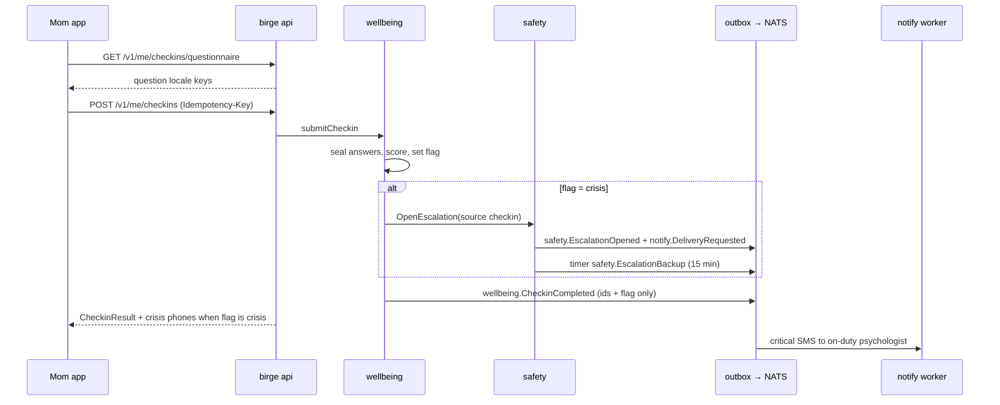
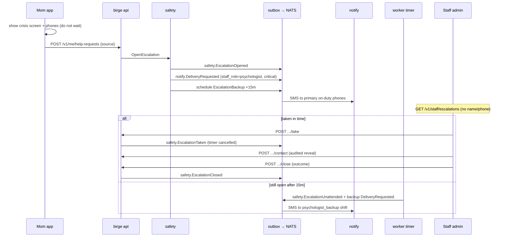

# End-to-end scenarios

These flows match the code and contracts as they are now. Endpoint paths are under `/v1` unless noted (`contracts/openapi/birge.yaml`). Events are in `contracts/events/`. Where a piece is still unfinished, this page says so and points to [roadmap.md](roadmap.md).

Staff UI steps: [handbook/staff.md](handbook/staff.md). System shape: [overview.md](overview.md).

---

## 1. Member sign-in by SMS code

Auth gateway (`internal/domains/membership/authgw`) sits at `/auth/` in front of the Kratos public API. Kratos is never exposed directly. Limits and PoW replay are process-local today; a shared store is still required before more than one API replica ([roadmap.md](roadmap.md) wave 1). SMS delivery goes through the Kratos courier → notify webhook path; wiring that courier hook in deployment is still open on the roadmap.

```mermaid
sequenceDiagram
  participant App as Mom app
  participant Meta as GET /v1/meta/client-config
  participant GW as Auth gateway /auth/
  participant Kratos as Ory Kratos
  participant Notify as notify (courier webhook)
  participant API as birge api

  App->>Meta: getClientConfig (crisis phones, versions)
  App->>GW: GET /auth/pow
  GW-->>App: PoW challenge
  App->>GW: POST /auth/self-service/login?... + X-Pow-Solution + E.164 phone
  Note over GW: PoW once, allowlist, per-IP / per-number / global limits
  GW->>Kratos: forward checked body
  Kratos->>Notify: courier webhook (code SMS)
  Notify-->>App: SMS with code (fixed template, no other content)
  App->>GW: POST login with code + fresh PoW
  GW->>Kratos: forward
  Kratos-->>App: session token
  App->>API: GET /v1/me (Bearer session)
  Note over API: lazy member create; membership.MemberRegistered
  API-->>App: Member profile
```

Steps:

1. App calls `getClientConfig` (no session) for crisis phones and version gates.
2. App solves `GET /auth/pow`, then posts login/registration under `/auth/self-service/...` with `X-Pow-Solution` and an allowed E.164 number (example shape: `+70000000000`).
3. Kratos sends the code via notify; member submits the code through the same gateway.
4. App calls `getMe` / `updateMe` with the session bearer; first call creates the member and emits `membership.MemberRegistered`.

---

## 2. Weekly check-in with a crisis flag

Wellbeing scores the questionnaire; a crisis flag opens an escalation through safety (source `checkin`) without waiting on the AI.



Steps:

1. `getQuestionnaire` then `submitCheckin` (`operationId`s in the OpenAPI wellbeing tag).
2. Answers are sealed; event payload is IDs and flag only — never answers.
3. On `flag=crisis`, safety opens (or reuses) an escalation; client shows the fixed crisis screen and phones even if the opener fails.
4. On `elevated`, the client may offer `requestHumanHelp` with `source: checkin` (member-initiated).

---

## 3. SOS / “contact a person” and escalation backup

Two different member actions:

| Intent | API | Who is alerted |
| --- | --- | --- |
| “I feel very bad” / contact a person | `POST /v1/me/help-requests` (`requestHumanHelp`) | On-duty psychologist (+ backup after 15 min) |
| Practical SOS (need help now) | `POST /v1/me/sos` (`raiseSos`) | Moderators + confirmed trusted contacts |

Childcare SOS never goes to the district feed (AGENTS.md non-negotiable 5; emergency share returns 409). Staff handle help-request escalations in the admin queue ([handbook/staff.md](handbook/staff.md)).



`raiseSos` similarly writes `emergency.SosRaised` and critical `notify.DeliveryRequested` to `staff_role=moderator` and each confirmed contact in one transaction, with an auto-close timer. Endpoints for contacts/moderators to *read* SOS text in admin are not built yet ([roadmap.md](roadmap.md) follow-ups).

---

## 4. Assistant: crisis before the LLM, then anonymization

Pipeline order is fixed in `internal/domains/assistant` (ADR-0023, ADR-0013). L1 lexicon never calls the model. Without `ai_crossborder` consent, nothing is stored or sent — except a crisis still returns phones and opens an escalation.

```mermaid
sequenceDiagram
  participant App as Mom app
  participant API as POST /v1/me/assistant/messages
  participant Asst as assistant
  participant Safety as safety L1 / OpenEscalation
  participant Privacy as privacy HasConsent
  participant Know as knowledge retrieval
  participant LLM as LLM provider

  App->>API: sendAssistantMessage (Idempotency-Key)
  API->>Asst: pipeline
  Asst->>Safety: Detect(raw text) L1
  alt L1 crisis
    Asst->>Safety: OpenEscalation(source assistant)
    API-->>App: crisis=true, phones, escalationId (no model)
  else not crisis
    Asst->>Privacy: ai_crossborder?
    alt no consent
      API-->>App: 403 consent_required
    else daily limit exceeded
      API-->>App: 429 (crisis would still bypass)
    else ok
      Asst->>Asst: anonymize (name dictionary, phones, …)
      Asst->>Know: retrieve fragments (TEI/Qdrant; optional)
      Asst->>LLM: anonymized text + fragments
      LLM-->>Asst: structured reply or failure
      Note over Asst: L2 crisis flag from model wins; else store sealed anonymized turns
      API-->>App: reply or degraded=true
    end
  end
```

Demo prompt and anonymization eval sets are marked draft / not psychologist-approved in the assistant README. `cmd/birge-eval` and the AI CI stage are still on the roadmap (ADR-0017).

---

## 5. Moderation of a reported chat message

```mermaid
sequenceDiagram
  participant Member as Member app
  participant Chat as chat
  participant Outbox as outbox → NATS
  participant Mod as moderation
  participant Staff as Staff admin
  participant Chat2 as chat consumer

  Member->>Chat: POST /v1/chat/messages/{id}/report
  Chat->>Outbox: chat.MessageReported
  Outbox->>Mod: queue item kind=report
  Staff->>Mod: GET /v1/staff/moderation/queue
  Mod-->>Staff: summary from ContentSource (message text, no contacts)
  Staff->>Mod: POST /v1/staff/moderation/items/{id}/decision
  Mod->>Outbox: moderation.Decided (approve / reject [, block_author, legal_hold])
  Outbox->>Chat2: ApplyModerationDecided
  Note over Chat2: reject hides message; block_author suspends; legal_hold preserves
```

Held messages (`chat.MessageHeld`) enter the same queue as kind `chat_message`. The admin UI today exposes approve / reject with a reason; `blockAuthor` and `legalHold` are on the API (`ModerationDecision`) and legal hold also has `PUT/DELETE /v1/staff/chat/messages/{id}/legal-hold`. Role matrix and remaining staff screens are still listed as later work on the roadmap.

---

## 6. Account deletion across contexts

```mermaid
sequenceDiagram
  participant App as Mom app
  participant Privacy as privacy
  participant Outbox as outbox → NATS
  participant Workers as deletion consumers
  participant Timer as privacy.DeletionDue
  participant Keys as KeyShredder / OpenBao
  participant Kratos as Kratos admin API

  App->>Privacy: POST /v1/me/deletion-request {"confirm":"DELETE"}
  Privacy->>Outbox: privacy.DataDeletionRequested {member_id, due_at}
  Privacy->>Timer: schedule shred (~24h)
  Outbox->>Workers: membership, notify, safety, wellbeing, emergency, assistant, circle, chat, sharing, directory
  Note over Workers: each durable *-deletion consumer; idempotent DeleteMember
  Timer->>Keys: shred member DEK
  Timer->>Privacy: clear consents, mark deletion completed
  Note over Workers: membership tombstone + membership.DeleteIdentity → Kratos
```

Moderation and knowledge keep decision / article rows that hold only IDs and codes (no member content). Safety keeps escalation shells (IDs, outcome) with personal note/district cleared so an open crisis is not silenced. After shred, sessions for that identity get 401.

---

## 7. Knowledge article: draft → review → publish

Roles: psychologist authors/publishes **self-help**; lawyer authors/publishes **rights**; admin may create topics of either kind. Author cannot publish their own version. Rights publish requires `sourceUrl`. Expiry: rights ≈ 6 months, self-help ≈ 12 months; `knowledge.ReviewDue` marks the review-due queue one month before (staff push/SMS for reviewers not wired yet — knowledge README follow-up).

```mermaid
sequenceDiagram
  participant Author as Staff author
  participant API as birge api
  participant Know as knowledge
  participant Outbox as outbox → NATS
  participant Reviewer as Staff reviewer
  participant Index as worker TEI/Qdrant

  Author->>API: POST /v1/staff/knowledge/articles (draft)
  Author->>API: PUT /v1/staff/knowledge/versions/{id}
  Author->>API: POST .../submit  (draft → in_review)
  Reviewer->>API: GET /v1/staff/knowledge/articles?status=in_review
  alt publish
    Reviewer->>API: POST .../publish
    Know->>Outbox: knowledge.ArticlePublished
    Outbox->>Index: index published fragment
    Note over Know: schedule ReviewDue + Expire timers; export via birge kb-export
  else reject
    Reviewer->>API: POST .../reject {reason}
    Note over Know: back to draft
  end
```

Member reads use `listKnowledgeTopics`, `listTopicArticles`, `getArticle`. Expired rights show as `being_rechecked` and are excluded from AI retrieval.
